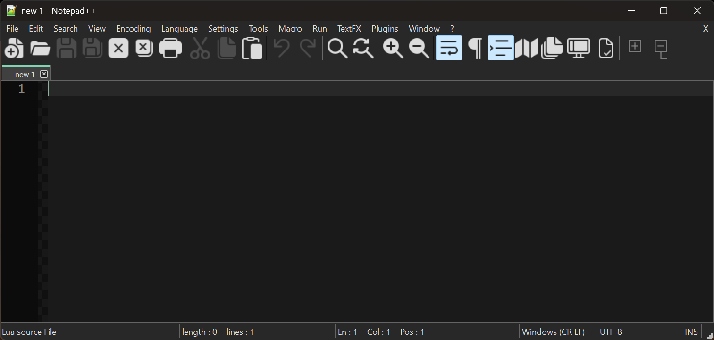
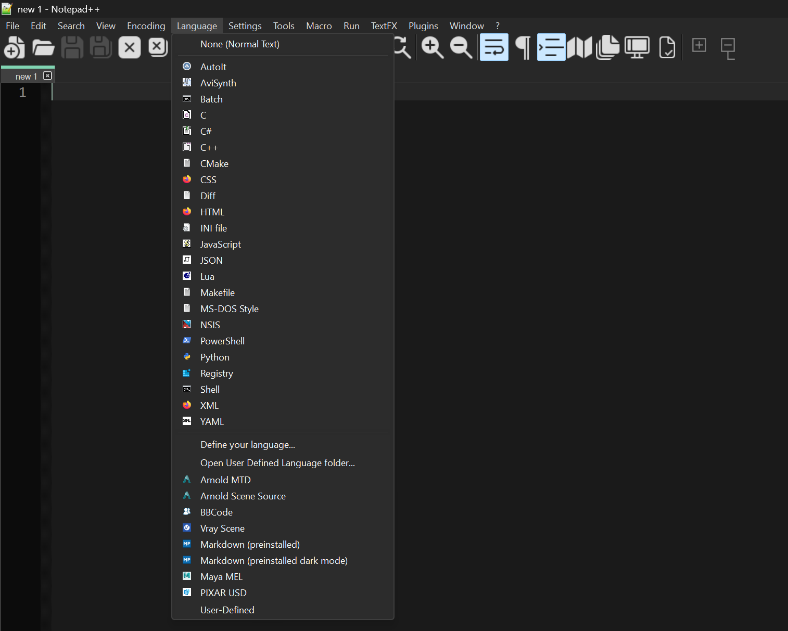
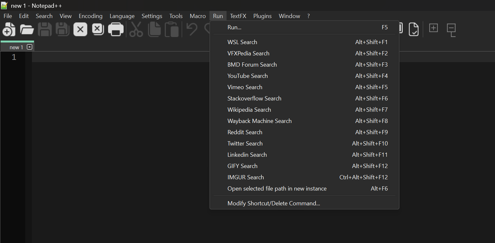
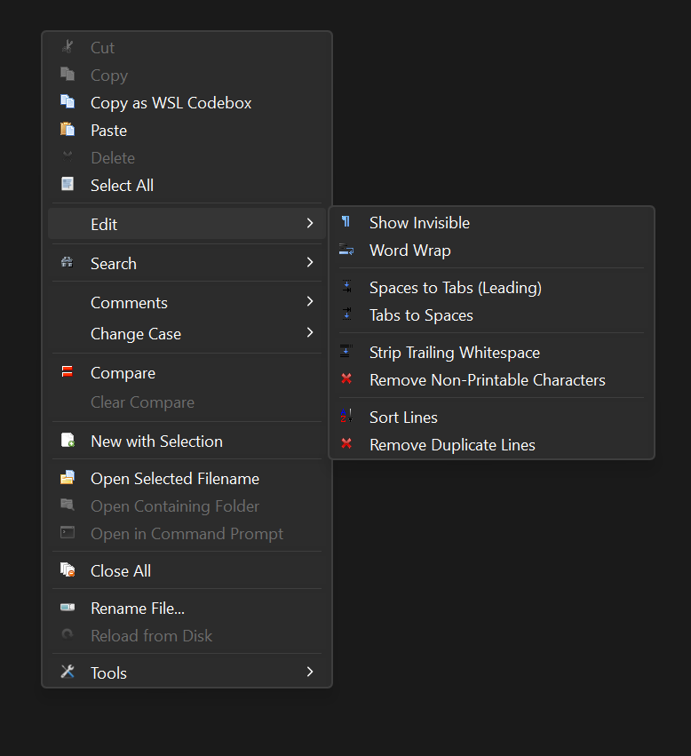
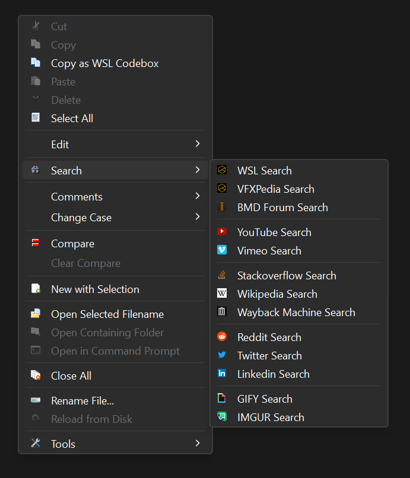
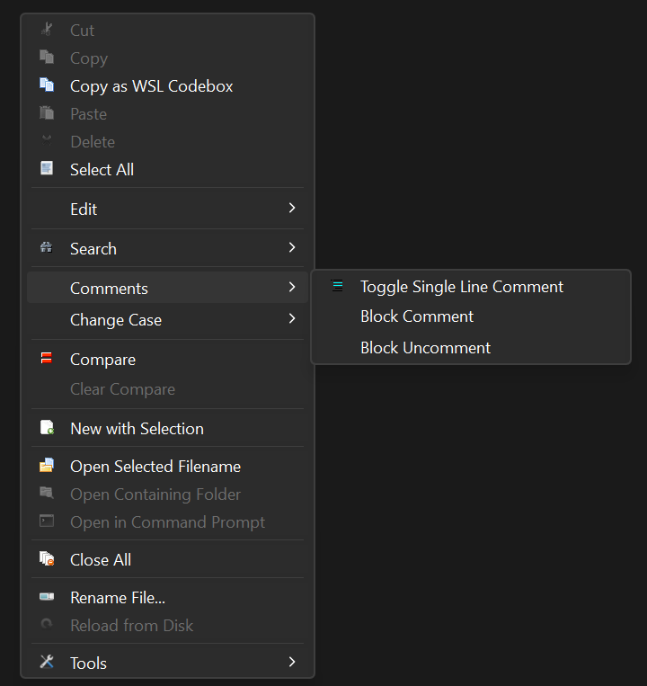
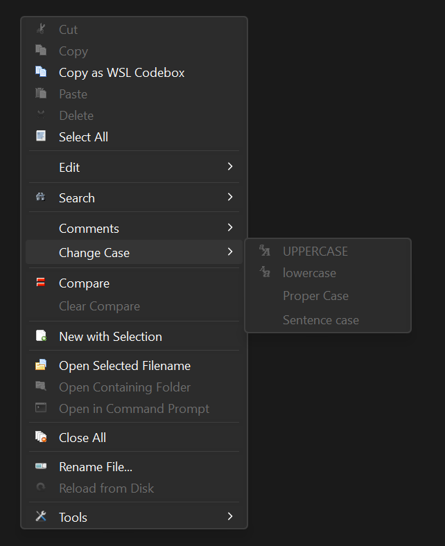
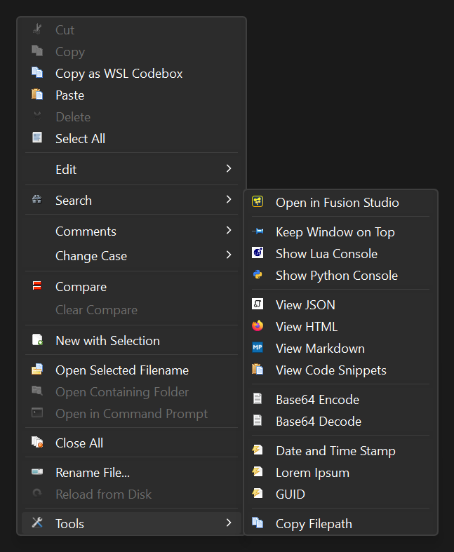

# Notepad++ for Fusion Customizations  
2021-12-06 09.34 AM  
By Andrew Hazelden <andrew@andrewhzelden.com>  

This project supplies a highly customized version of Notepad++ that adds a lot of convenience festures. It was created to help pipeline TDs in the visual effects sector get more out of their Notepadd++ user experience.

## Screenshots

## NPP Plugins:

- ComparePlugin
- CustomizeToolbar
- DSpellCheck
- Explorer
- LuaScript
- MenuIcons
- mimeTools
- NppConverter
- NppExport
- NPPJSONViewer
- NppMarkdownPanel
- NppSnippets
- NppTextFX
- NppToolBucket
- PreviewHTML
- PythonScript
- XMLTools

## Contextual (Right-Click) Menus:
	
- Cut
- Copy
- Copy as WSL Codebox
- Paste
- Delete
- Select All
- ---------------------
- Edit
	- Show invisible
	- Word Wrap
	- --------------------------
	- Spaces to Tabs (Leading)
	- Tabs to Spaces
	- --------------------------
	- Strip Trailing Whitespace
	- Remove Non-Printable Characters
	- --------------------------
	- Sort Lines
	- Remove Duplicate Lines
- ---------------------
- Search
	- WSL Search
	- VFXPedia Search
	- BMD Forum Search
	- --------------------------
	- YouTube Search
	- Vimeo Search
	- --------------------------
	- Stackoverflow Search
	- Wikipedia Search
	- Wayback Machine Search
	- --------------------------
	- Reddit Search
	- Twitter Search
	- Linkedin Search
	- --------------------------
	- GIFY Search
	- IMGUR Search
- --------------------
- Comments
	- Toggle Single Line Comment
	- Block Comment
	- Block Uncomment
- Change Case
	- UPPERCASE
	- lowercase
	- Proper Case
	- Sentence case
- --------------------
- Compare
- Clear Compare
- --------------------
- New with Selection
- ---------------------
- Open Selected Filename
- Open Containing Folder
- Open in Command Prompt
- ---------------------
- Close All
- ---------------------
- Rename File...
- Reload from Disk
- ---------------------
- Tools
	- Open in Fusion Studio
	- --------------------------
	- Keep Window on Top
	- Show Lua Console
	- Show Python Console
	- --------------------------
	- View JSON
	- View HTML
	- View Markdown
	- View Code Snippets
	- -------------------------- 
	- Base64 Encode
	- Base64 Decode
	- --------------------------
	- Date and Time Stamp
	- Lorem Ipsum
	- GUID
	- --------------------------
	- Copy Filepath

## Run Menu:

- WSL Search
- VFXPedia Search
- BMD Forum Search
- YouTube Search
- Vimeo Search
- Stackoverflow Search
- Wikipedia Search
- Wayback Machine Search
- Reddit Search
- Twitter Search
- Linkedin Search
- GIFY Search
- IMGUR Search
- Open Selected file path in new instance

## Macro Menu:
	
 - New With Selection (Alt+Shift+C)
 - Copy as WSL Codebox (Ctrl+Shift+C)
 - Select All Copy
 - Remove Non-Printable Characters

## Snippets Libraries

 - BBCode
 - UI Manager - Lua
 - UI Manager - Python

# User Defined Languages

 - Arnold Scene Source
 - Arnold MTD
 - BBCode
 - Markdown
 - Maya MEL
 - Pixar USD
 - Vray Scene

## Custom Macro Creation Steps

### Remove Non-Printable Characters Macro

- "Edit > Select All" menu
- "Encoding > Convert to ANSI" menu
- Find & Replace - Replace All:
 - Find what: `[\x00-\x08\x0B\x0C\x0E-\x1F\x7F-\x9F\s]`
  (This represents all non-printable control characters, null, and all white space characters like Spaces, Tabs, New Line, Carriage Returns)
 - Replace with: `""` (Blank)  
 - [x] Wrap Around
 - (x) Regular expression
- "Edit > Select All" menu

## NPP User Interface Adjustments:

- Settings > Style Configurator > Select theme > FusionDarkMode
	
- Language > Style Configurator > Select theme > <Applied to all Themes > Language > User ext.: atom blocklist comp cfg dfq def eyeonscript flt fu fuse guide library layout setting toolbars prefs scriptlib
	
- Language > Style Configurator > Select theme > FusionDarkMode > Language > Lua > Style > FUNC3 > User-defined keywords > `eyeon.CopyCineonSettings`, `eyeon.GetLoaders`, `eyeon.GetSavers`, `eyeon.LD_GetFrames`, `eyeon.MoveClip`, `eyeon.SV_GetFrames`, `eyeon.UIDispatcher`, `eyeon._VERSION`, `eyeon.allocconsole`, `eyeon.asyncscriptapp`, `eyeon.convertIDtoChar`, `eyeon.copyfile`, `eyeon.crash`, `eyeon.createdir`, `eyeon.createuuid`, `eyeon.defragfile`, `eyeon.defragsequence`, `eyeon.direxists`, `eyeon.executebg`, `eyeon.exit`, `eyeon.fileexists`, `eyeon.fprint`, `eyeon.fullpath`, `eyeon.get_table_index`, `eyeon.getappname`, `eyeon.getappuuid`, `eyeon.getclipboard`, `eyeon.getcurrentdir`, `eyeon.getextension`, `eyeon.getfilename`, `eyeon.getfilepath`, `eyeon.getpid`, `eyeon.getstateindex`, `eyeon.gettime`, `eyeon.getuptime`, `eyeon.getusing`, `eyeon.isin`, `eyeon.isvalidname`, `eyeon.nextstate`, `eyeon.noise`, `eyeon.obtaingloballock`, `eyeon.openfileexternal`, `eyeon.openurl`, `eyeon.parseFilename`, `eyeon.pathIsMovieFormat`, `eyeon.pinghosts`, `eyeon.readdir`, `eyeon.readfile`, `eyeon.readstring`, `eyeon.releasegloballock`, `eyeon.removedir`, `eyeon.scriptapp`, `eyeon.sendnotify`, `eyeon.setapptitle`, `eyeon.setclipboard`, `eyeon.setcurrentdir`, `eyeon.settrcontext`, `eyeon.split`, `eyeon.startserver`, `eyeon.stripname`, `eyeon.suspend`, `eyeon.tounc`, `eyeon.touserdata`, `eyeon.translate`, `eyeon.trim`, `eyeon.trimExtension`, `eyeon.trimSequence`, `eyeon.using`, `eyeon.version`, `eyeon.wait`, `eyeon.writefile`, `eyeon.writestring`, `bmd.CopyCineonSettings`, `bmd.GetLoaders`, `bmd.GetSavers`, `bmd.LD_GetFrames`, `bmd.MoveClip`, `bmd.SV_GetFrames`, `bmd.UIDispatcher`, `bmd._VERSION`, `bmd.allocconsole`, `bmd.asyncscriptapp`, `bmd.convertIDtoChar`, `bmd.copyfile`, `bmd.crash`, `bmd.createdir`, `bmd.createuuid`, `bmd.defragfile`, `bmd.defragsequence`, `bmd.direxists`, `bmd.executebg`, `bmd.exit`, `bmd.fileexists`, `bmd.fprint`, `bmd.fullpath`, `bmd.get_table_index`, `bmd.getappname`, `bmd.getappuuid`, `bmd.getclipboard`, `bmd.getcurrentdir`, `bmd.getextension`, `bmd.getfilename`, `bmd.getfilepath`, `bmd.getpid`, `bmd.getstateindex`, `bmd.gettime`, `bmd.getuptime`, `bmd.getusing`, `bmd.isin`, `bmd.isvalidname`, `bmd.nextstate`, `bmd.noise`, `bmd.obtaingloballock`, `bmd.openfileexternal`, `bmd.openurl`, `bmd.parseFilename`, `bmd.pathIsMovieFormat`, `bmd.pinghosts`, `bmd.readdir`, `bmd.readfile`, `bmd.readstring`, `bmd.releasegloballock`, `bmd.removedir`, `bmd.scriptapp`, `bmd.sendnotify`, `bmd.setapptitle`, `bmd.setclipboard`, `bmd.setcurrentdir`, `bmd.settrcontext`, `bmd.split`, `bmd.startserver`, `bmd.stripname`, `bmd.suspend`, `bmd.tounc`, `bmd.touserdata`, `bmd.translate`, `bmd.trim`, `bmd.trimExtension`, `bmd.trimSequence`, `bmd.using`, `bmd.version`, `bmd.wait`, `bmd.writefile`, `bmd.writestring`
	
- Language > Style Configurator > Select theme > FusionDarkMode > Language > Lua > Style > FUNC1 > User-defined keywords > `_AUTHOR` `FuPLATFORM_WINDOWS` `FuPLATFORM_LINUX` `FuPLATFORM_MAC`
	
- Settings > Style Configurator > Language > Global Styles > Style > Global override > Enable global background color (enabled)
- Settings > Style Configurator > Language > Global Styles > Style > Global override > Font name > Consolas
- Settings > Style Configurator > Language > Global Styles > Style > Global override > Font size > 12 pt
- Settings > Style Configurator > Language > Global Styles > Style > Global override > Enable global font (enabled)
- Settings > Style Configurator > Language > Global Styles > Style > Global override > Enable global font size (enabled)
	
- Settings > Style Configurator > Language > Global Styles > URL hovered > Foreground Color > RGB 101/111/147
- Settings > Style Configurator > Language > Global Styles > Foreground Color > RGB 180/180/180
- Settings > Style Configurator > Language > Global Styles > Default Style > Foreground color > RGB 146/146/146
- Settings > Style Configurator > Language > Global Styles > Default Style > Background color > RGB 26/26/26
- Settings > Style Configurator > Language > Global Styles > Current Line background > Background color > RGB 40/40/40
- Settings > Style Configurator > Language > Global Styles > Selected text color > Foreground color > RGB 143/143/143
- Settings > Style Configurator > Language > Global Styles > Selected text color > Background color > RGB 57/57/57
- Settings > Style Configurator > Language > Global Styles > Smart Highlight > Background color > RGB 101/111/147
- Settings > Style Configurator > Language > Global Styles > Tags match highlight > Background color > RGB 246/223/60
- Settings > Style Configurator > Language > Global Styles > Tags attribute > Background color > RGB 39/161/131
	
- Settings > Preferences > General > Filled Fluent UI: Large
- Settings > Preferences > General > Tab Bar > Alternative Icons
- Settings > Preferences > General > Tab Bar > Draw a colored bar on active tab
	
- Settings > Preferences > Editing > Caret Settings > Width > 2
- Settings > Preferences > Editing > Enable current line highlighting (enabled)
- Settings > Preferences > Editing > Enable smooth font (enabled)
- Settings > Preferences > Editing > Enable scrolling beyond last line (enabled)
	
- Settings > Preferences > Multi-Instance & Date > Customize insert Date Time > Custom format: `yyyy-MM-dd hh:mm tt (2021-11-20 10:18PM)`

- Settings > Preferences > Dark mode > Enable dark mode (enabled)
- Settings > Preferences > Dark mode > Customize tone > Top> RGB 40/40/40
- Settings > Preferences > Dark mode > Customize tone > Menu hot track > RGB 64/64/64
- Settings > Preferences > Dark mode > Customize tone > Active > RGB 64/64/64
- Settings > Preferences > Dark mode > Customize tone > Main > RGB 40/40/40
- Settings > Preferences > Dark mode > Customize tone > Error > RGB 208/68/46
- Settings > Preferences > Dark mode > Customize tone > Text > RGB 224/224/224
- Settings > Preferences > Dark mode > Customize tone > Link > RGB 255/255/0
	
- Settings > Preferences > Margins/Border/Edge > Folder Margin Style > Box tree
	
- Settings > Preferences > New Document > Default language > Lua
	
- Settings > Preferences > Language >Language Menu > Make language menu compact (disabled)
- Settings > Preferences > Language > Tab Settings > Tab size: 2
	
- Settings > Preferences > Backup > Remember current session for next launch (enabled)
- Settings > Preferences > Backup > Enable session snapshot and periodic backup (enabled)
	
- Settings > Preferences > Search Engine > Set your search engine here: `https://www.steakunderwater.com/wesuckless/search.php?keywords=$(CURRENT_WORD)`
	
- Plugins > Compare > Settings... > Color settings > Added line: > RGB 17/68/55
- Plugins > Compare > Settings... > Color settings > Deleted line: > RGB 70/22/15
- Plugins > Compare > Settings... > Color settings > Moved line: > RGB 34/38/51
- Plugins > Compare > Settings... > Color settings > Changed line: > RGB 69/69/16
- Plugins > Compare > Settings... > Color settings > Change highlight: > RGB 85/43/0
	
- View > Word Wrap (enabled)

## Menu Icons:

Custom 16x16 px sized .ico image resources were prepared for the Language menu, Run menu, and several other menu entries.

